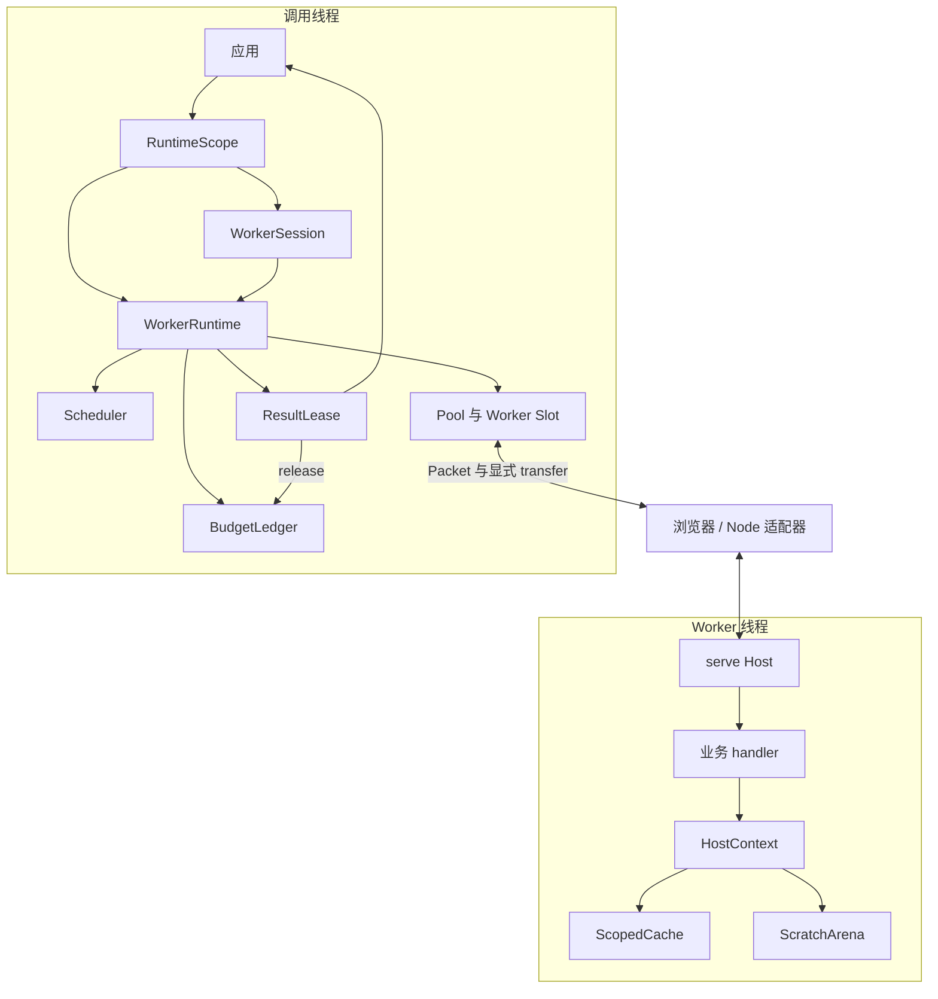

调用线程负责准入、调度和生命周期，Worker 负责业务计算。两端通过版本化协议交换数据，消费者通过结果租约参与资源归还。

## 模块边界

| 模块 | 职责 | 源码位置 |
| --- | --- | --- |
| Runtime | Pool、Scope、Session 与任务阶段协调 | `src/runtime/runtime.ts` |
| Scheduler | 优先级、组公平和阻塞唤醒 | `src/runtime/scheduler.ts` |
| Host | 注册任务、检查输出、取消与清理 | `src/host.ts` |
| 数据层 | Packet 编解码、计费和所有权检查 | `src/packet.ts`、`src/binary.ts` |
| 资源层 | 预算、租约、缓存与 scratch | `src/resources/` |
| 适配器 | 消息、故障和物理终止 | `src/adapters/` |

准入、亲和性、Pool 和 Slot 由 runtime.ts 内部协调。上图是职责分层，并不意味着它们分别实现为独立服务。

继续阅读[任务时序](execution/)、[协议与故障](protocol/)、[资源释放边界](resources/)或[文档网站架构](website/)。

## 源码与契约

- [src/runtime/runtime.ts](https://github.com/mapseekai/tasklane/blob/b40ba606552c4b798ebb803528548151186b364b/src/runtime/runtime.ts)
- [src/runtime/scheduler.ts](https://github.com/mapseekai/tasklane/blob/b40ba606552c4b798ebb803528548151186b364b/src/runtime/scheduler.ts)
- [src/host.ts](https://github.com/mapseekai/tasklane/blob/b40ba606552c4b798ebb803528548151186b364b/src/host.ts)
- [docs/architecture.md](https://github.com/mapseekai/tasklane/blob/b40ba606552c4b798ebb803528548151186b364b/docs/architecture.md)
