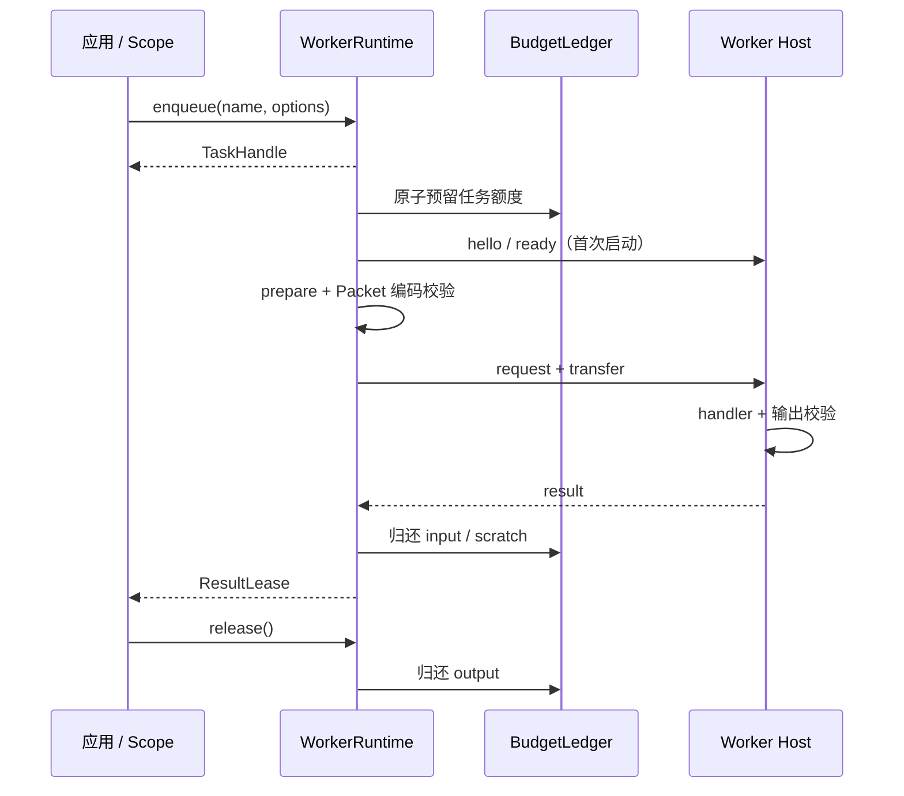

同步输入任务先获得 Worker 与额度，再运行 `prepare`；异步输入准备先取得准备窗口与额度，直到执行准入才绑定 Worker。

## 任务阶段

公开状态包括 queued、starting、preparing、prepared、running、cancelling、succeeded、failed 和 cancelled。逻辑状态与物理完成分别管理，避免取消后过早归还实际仍占用的容量。

异步准备的 execution deadline 从准备准入开始。取消后的迟到输入不会被强制转移，准备回调物理结束后才归还其资源。

## 消费端的影响

Worker 返回成功结果后即可参与后续物理任务，但旧结果的 output 额度继续由租约持有。生产者用有限提交窗口控制闭包和 Promise 数量，消费者逐块归还结果额度。

## 源码与契约

- [src/runtime/runtime.ts](https://github.com/mapseekai/tasklane/blob/b40ba606552c4b798ebb803528548151186b364b/src/runtime/runtime.ts)
- [src/resources/lease.ts](https://github.com/mapseekai/tasklane/blob/b40ba606552c4b798ebb803528548151186b364b/src/resources/lease.ts)
- [src/host.ts](https://github.com/mapseekai/tasklane/blob/b40ba606552c4b798ebb803528548151186b364b/src/host.ts)
