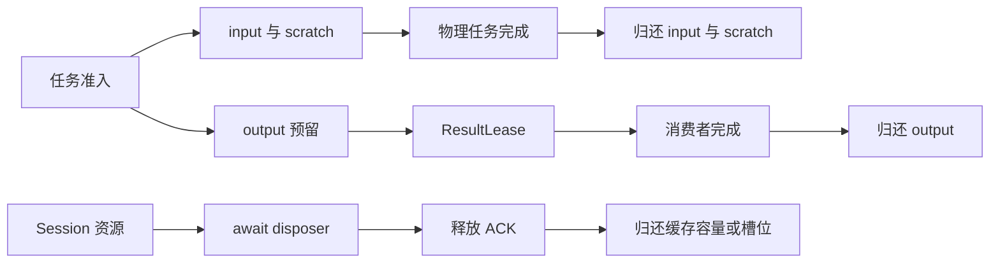

资源释放以所有者和物理完成为边界。逻辑任务取消不能证明 Worker、准备阶段或外部资源已经停止使用内存。

## 声明和实际分配

BudgetLedger 约束显式额度，Packet 校验传输计费量，ScratchArena 度量经其分配的 buffer。直接分配的 JS 对象、WASM 堆与 native 资源需要算法自身控制。

缓存容量预留与缓存当前使用量也不同。删除单个条目降低本地使用量，不等于自动降低 Worker 的全局缓存容量预留。

## 失败时保留所有权

不透明资源的 disposer 失败时保留条目，以便再次清理。Worker 终止失败时保留物理容量。应用应在实际资源销毁后缩小或释放 resident 租约。

结果租约释放不能抹去消费者另存的引用。应用若保留已消费结果，应把该内存转为自己的生命周期预算，并采用可观测的上限。

## 源码与契约

- [src/resources/budget.ts](https://github.com/mapseekai/tasklane/blob/b40ba606552c4b798ebb803528548151186b364b/src/resources/budget.ts)
- [src/resources/cache.ts](https://github.com/mapseekai/tasklane/blob/b40ba606552c4b798ebb803528548151186b364b/src/resources/cache.ts)
- [src/resources/lease.ts](https://github.com/mapseekai/tasklane/blob/b40ba606552c4b798ebb803528548151186b364b/src/resources/lease.ts)
- [src/resources/resident.ts](https://github.com/mapseekai/tasklane/blob/b40ba606552c4b798ebb803528548151186b364b/src/resources/resident.ts)
