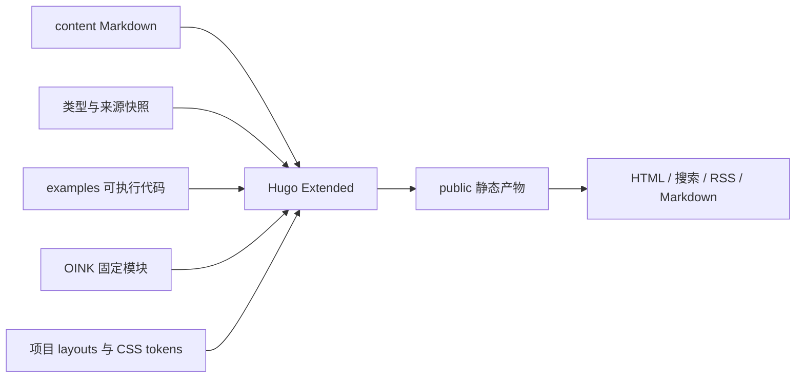

tasklane-web 是独立的 Hugo 静态站点，使用固定版本 OINK 模块提供 Docs、Blog、全文搜索、目录、代码高亮和图表运行时。阅读站点不需要后端服务。

## 内容组织

快速开始是学习路径；使用指南解决具体操作；核心概念和运行时架构解释机制；API 参考提供字段与签名。版本变化归档在 Blog，避免把交付历史混入当前契约。

| 路径 | 维护内容 | 验证方式 |
| --- | --- | --- |
| `content/docs/` | 教程、指南、解释与参考 | 链接与 front matter 检查 |
| `content/blog/releases/` | 原 Changelog 的版本记录 | 版本、日期与来源核对 |
| `examples/` | 页面引用的可执行示例 | TypeScript 与 Node 断言 |
| `assets/reference/` | API 类型快照 | 随源码版本核对 |
| `data/upstream.json` | 版本与源码依据 | 指向固定源码快照 |
| `layouts/` | 首页与少量主题覆盖 | Hugo 构建与响应式检查 |
| `assets/css/` | Hallmark tokens 与站点样式 | 静态设计检查与浏览器复核 |

## 设计与交付

OINK 提供阅读框架，Hallmark Cobalt 统一首页与阅读页面的颜色、字体和交互焦点。主题脚本和字体随模块本地提供；Mermaid 仅在需要的页面加载。

GitHub Actions 在 main 分支推送后执行构建、链接与示例检查，通过后部署到 GitHub Pages。Pull request 只执行检查。站点发布在 `/tasklane-web/` 子路径，首页 canonical URL 用于确定链接校验的路径边界。本地构建和维护命令见随网站源码交付的 README.md。
