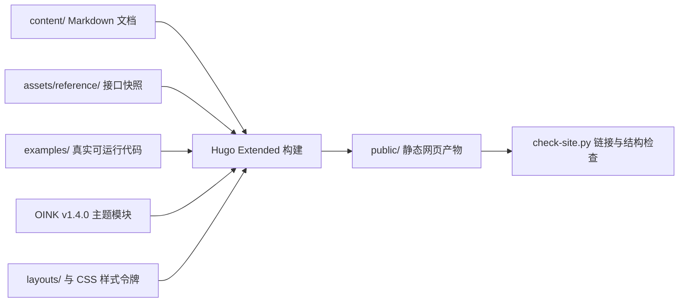

你现在浏览的 `tasklane-web` 是一个独立于运行时代码仓库的纯静态文档网站。它使用 **Hugo Extended** 配合固定版本的 **[OINK v1.4.0](https://github.com/pgsty/oink/tree/v1.4.0)** 主题模块构建，无需任何后端服务，自带离线中文全文搜索、代码高亮、深浅色主题切换和 Mermaid 架构图渲染。



## 为什么文档里的代码和类型不会“过期失效”？

写技术文档最怕的是：文档里贴的示例代码根本跑不通，或者 API 参数表跟真实代码早就对不上了。为了解决这个问题，本站把“写文字”和“管代码”连成了一条自动化流水线：

| 仓库目录或文件 | 里面放的是什么 | 怎么保证它绝对不出错？ |
| --- | --- | --- |
| **`examples/`** | [快速开始](/docs/start/)教程里展示的 Node.js 和浏览器示例代码 | 文档里不手抄代码，而是用 `` 短代码直接读取这里的文件；每次运行 `pnpm check` 时，都会先用 `tsc --noEmit` 检查类型，再用 `node examples/node/main.mjs` 真实跑一遍断言 |
| **`assets/reference/`** | [API 参考](/docs/reference/)各页底部展示的完整 TypeScript 接口声明 | 用 `` 短代码直接嵌入页面，与运行时源码的 `src/types.ts` 保持同步 |
| **`data/upstream.json`** | 记录当前文档锁定的 `tasklane` 版本号（`0.2.0-beta.2`）、源码 commit 与协议版本（`v7`） | 全站所有的源码跳转链接都锁定在这个 commit 快照上，不会因为主分支后续改动而指向错误的行号 |
| **`content/`** | 全站所有的教程、概念、指南、参考与版本记录 Markdown | `scripts/check-site.py` 会强制检查每一页是否都写了 `title`、`description` 和符合 Diátaxis 规范的 `doc_type` |
| **`public/`** | Hugo 构建出来的最终静态网页 | `scripts/check-site.py` 会把所有生成的 HTML 解析一遍，确保每页只有 1 个 `h1`、没有任何重名的标题锚点 `id`，且全站 4,000 多处内部链接与 `#anchor` 锚点 100% 能点通 |

## 本地预览与检查命令

如果你修改了文档内容或样式，只需在仓库根目录下运行一行命令即可完成全套构建与校验：

```sh
pnpm check
```

当修改推送到 GitHub `main` 分支时，GitHub Actions 会自动跑一遍同样的 `pnpm check`，全部通过后自动发布到 GitHub Pages（`/tasklane-web/`）。更多本地开发说明见仓库根目录的 `README.md`。
