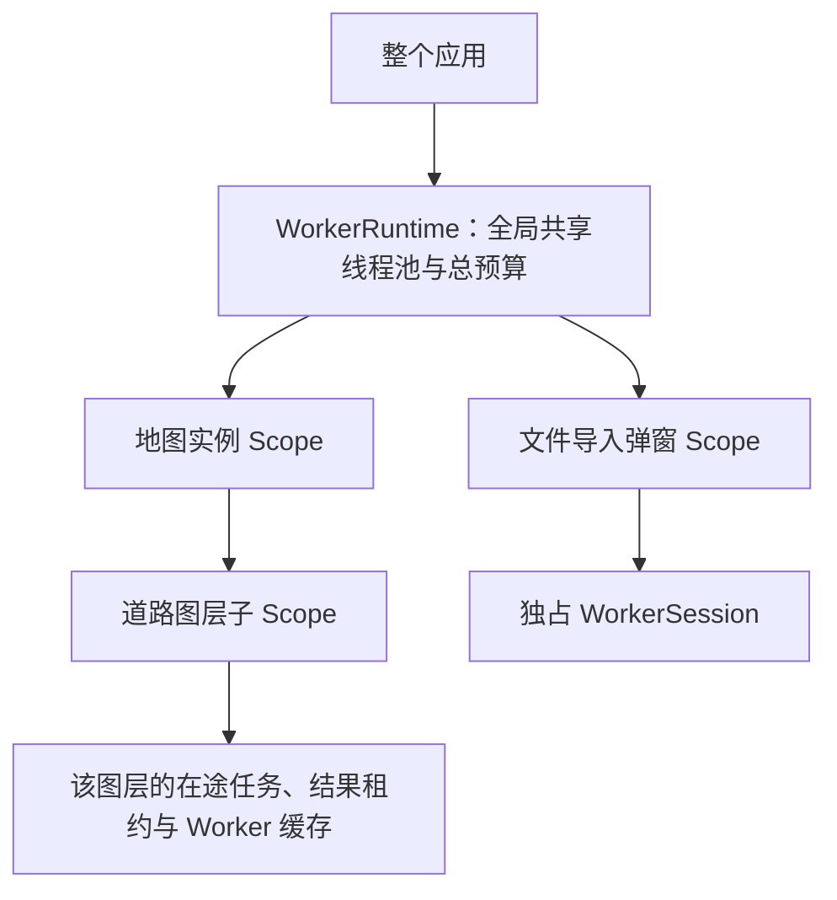

想象一个地图或数据分析应用：用户先打开了“道路图层”和“建筑图层”，提交了几百个后台解析任务；两秒后，用户关掉了“道路图层”。

这时你会面临一个两难问题：
- 如果每个图层各自去创建一套独立的 Worker 线程池，打开十几个图层就会拉起几十个后台线程，直接把浏览器或服务器拖垮；
- 可如果所有图层共用同一个全局队列，当“道路图层”关闭时，你又怎么精准地**只取消道路图层的排队任务、只回收道路图层的未消费结果、只清空 Worker 里属于道路图层的缓存**，而不误伤正在正常工作的“建筑图层”？

为了同时兼顾**全局资源共享**与**局部干净销毁**，`tasklane` 把生命周期分成了两层：**`WorkerRuntime`（管全局线程池与总额度）** 和 **`RuntimeScope`（管单个业务模块的归属与清理）**。

## 一张表看懂 `Runtime` 与 `Scope` 的分工

| 对象 | 谁来创建和持有 | 什么时候销毁 | 负责管什么 |
| --- | --- | --- | --- |
| **`WorkerRuntime`** | 整个应用（通常全局只建 1 个） | 应用退出或彻底卸载时调用 `runtime.dispose()` | 统一管理所有 Worker Pool、最大物理线程数（`maxWorkers`）、五类总内存预算与全局调度器 |
| **`RuntimeScope`** | 单个页面、地图、数据源、图层或弹窗 | 该模块关闭或操作结束时调用 `scope.dispose()`（或用 `withScope` 自动销毁） | 为该模块提交的任务、结果租约（`ResultLease`）、独占会话（`Session`）及 Worker 本地缓存提供独立的命名空间与一键清理边界 |

`Scope` 支持像文件夹一样嵌套（通过 `scope.createScope('roads')` 创建子 `Scope`，全局默认最多支持 `4096` 个）。当你销毁父 `Scope` 时，它下面的所有子 `Scope` 也会一并自动销毁。

## 调用 `scope.dispose()` 时，底层究竟发生了什么？

对于一次性的短操作，推荐用 `await runtime.withScope('import', async (scope) => { ... })`，走出大括号时它会自动帮你销毁；对于长驻组件，则在组件卸载时调用 `await scope.dispose()`。

需要特别强调的是：**`scope.dispose()` 不是简单地把对象标为已删除，而是一个“确保底层真的清理干净了才返回”的异步清理屏障**。它会依次等待以下事情全部完成：

1. **取消并等待任务停下**：取消该 `Scope`（及子 `Scope`）下所有还在排队或运行中的任务，并等待正在跑的物理任务或 `prepareAsync` 回调真正退栈；
2. **关闭关联的 `Session`**：关闭该 `Scope` 创建的所有独占会话；
3. **等待 Worker 确认清空缓存（Release ACK）**：向所有曾为该 `Scope` 存过本地缓存或数据库/WASM 资源（`setResource`）的 Worker 发送清理指令，等待 Worker 执行完资源的异步 `disposer` 关闭函数并回传匹配当前 Worker 代际（`epoch`）的确认消息（默认超时 `releaseTimeoutMs = 10000` ms）。

如果某个数据库连接在关闭（`disposer`）时报错，或者确认超时，`scope.dispose()` 会如实抛出错误，并且**继续保留该资源占用的内存额度**，绝不会在底层还没释放干净时谎报成功。等你排除了外部故障后，可以再次调用 `scope.dispose()` 重试。

> **如果调用方不想等那么久怎么办？（`disposeWithin`）**
> `scope.disposeWithin(ms)` 和 `runtime.disposeWithin(ms)` 允许你只等待指定的毫秒数就继续往下走；但请注意，超时后**后台的清理动作依然在继续运行**，在清理真正完成前，对应的线程槽位和内存额度仍处于被保护占用状态。

## 为什么要区分 `handle.result` 与 `handle.settled`？

当你调用 `handle.cancel()` 取消一个正在 Worker 里运行的任务时，会存在一个时间差：**你的界面希望立刻停止等待，但后台线程里的循环可能还要跑几毫秒才能安全退出。**

因此，任务句柄 `TaskHandle` 提供了两个不同的 Promise，分别服务于这两种需求：

- **`handle.result`（面向业务逻辑与 UI）**：一旦发起取消，只要结果还没生成，`handle.result` 会**立即**以 `ABORTED` 错误拒绝，让你的前端界面马上解除 Loading 状态，无需干等后台线程停下。
- **`handle.settled`（面向物理资源确认）**：它永远不会报错拒绝，但一定会**等到后台 Worker 真正停止执行该任务（或 `prepareAsync` 真正退出），且输入与暂存内存额度已经归还给账本后**才会完成。当你在测试或严谨的资源交接中需要确认“后台真的不占 CPU 和输入内存了”，请 `await handle.settled`。

同样地，如果 Runtime 在强行杀死（`terminate`）一个卡死的 Worker 时底层操作系统或平台返回了失败，Runtime 会把该 Worker 放进隔离列表（`stats.quarantinedWorkers`）并继续扣留它占用的名额，直到你后续调用 `await runtime.retryTermination()` 确认它真正退出为止。

## 源码与契约

- [src/runtime/runtime.ts](https://github.com/mapseekai/tasklane/blob/b40ba606552c4b798ebb803528548151186b364b/src/runtime/runtime.ts)
- [src/types.ts](https://github.com/mapseekai/tasklane/blob/b40ba606552c4b798ebb803528548151186b364b/src/types.ts)
- [docs/resources.md](https://github.com/mapseekai/tasklane/blob/b40ba606552c4b798ebb803528548151186b364b/docs/resources.md)
