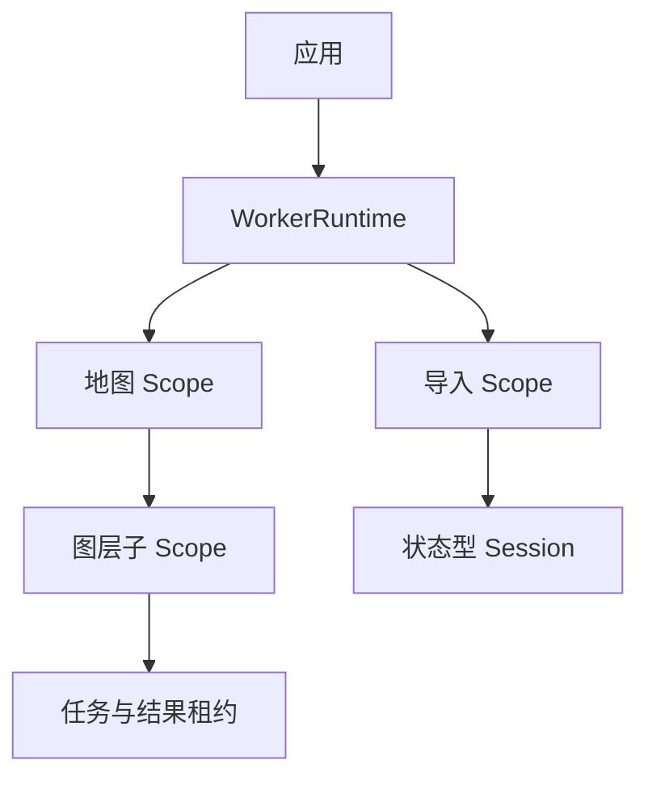

Runtime 由应用持有，Scope 由业务对象持有。地图、文档、数据集或插件关闭时，销毁各自的 Scope；应用退出时关闭 Runtime。

## Scope 的清理边界

`runtime.withScope(label, callback)` 在回调结束后销毁 Scope。手动创建的 Scope 使用 `await scope.dispose()`。清理会等待任务、子 Scope、Session 与对应 Worker 的资源释放确认。

`disposeWithin(ms)` 限制的是调用者等待时间，后台清理仍会继续。它不会保证在期限内强制释放物理资源。清理失败应保留错误，并根据诊断进行重试。

## 逻辑结束与物理完成

取消可以让 `handle.result` 提前拒绝。`handle.settled` 等待物理任务或准备阶段结束，并且自身不拒绝。需要任务失败信息时观察 `result`。

Worker 的物理终止失败会保留隔离状态和容量额度。把清理的 Promise 兑现作为资源可重新使用的依据，避免在失败时重复分配实际容量。

## 源码与契约

- [src/runtime/runtime.ts](https://github.com/mapseekai/tasklane/blob/b40ba606552c4b798ebb803528548151186b364b/src/runtime/runtime.ts)
- [src/types.ts](https://github.com/mapseekai/tasklane/blob/b40ba606552c4b798ebb803528548151186b364b/src/types.ts)
- [docs/resources.md](https://github.com/mapseekai/tasklane/blob/b40ba606552c4b798ebb803528548151186b364b/docs/resources.md)
