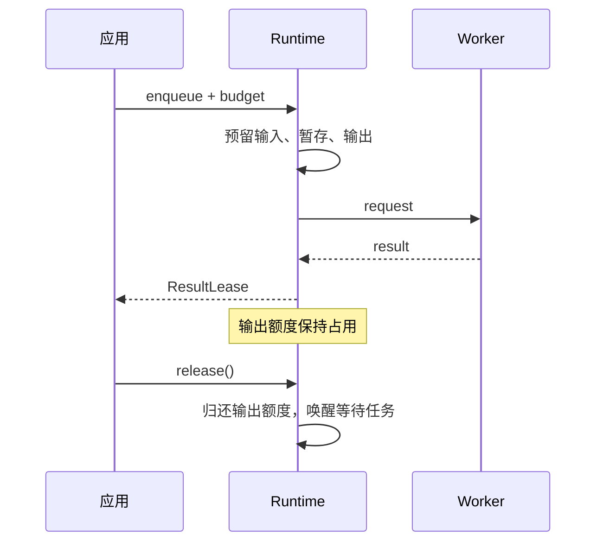

任务成功后返回 ResultLease。消费者持有租约时，输出额度保持占用；释放后，等待相同额度的任务才有机会继续执行。



## 默认消费方式

使用 `consumeResult(handle, consume)`。它在消费者成功或抛错时都释放租约。

```ts
await consumeResult(handle, async (value) => {
  await writeChunk(value);
});
```

手动读取时，在 `finally` 中调用 `lease.release()`。释放后访问 `lease.value` 会抛出 `RESULT_RELEASED`。

## 仅等待完成

不需要值时，提交任务时设置 `discardResult: true`。成功后 Runtime 自动归还输出额度；其 `result` 解析为已释放租约，`settled` 可用于等待物理完成。需要知道业务是否失败时，仍需观察 `result`。

仅等待普通任务的 `settled` 不会消费成功结果。长期持有结果也可能用尽 `maxResultLeases`，即使值没有二进制缓冲区。

## 源码与契约

- [src/index.ts](https://github.com/mapseekai/tasklane/blob/b40ba606552c4b798ebb803528548151186b364b/src/index.ts)
- [src/resources/lease.ts](https://github.com/mapseekai/tasklane/blob/b40ba606552c4b798ebb803528548151186b364b/src/resources/lease.ts)
- [src/types.ts](https://github.com/mapseekai/tasklane/blob/b40ba606552c4b798ebb803528548151186b364b/src/types.ts)
