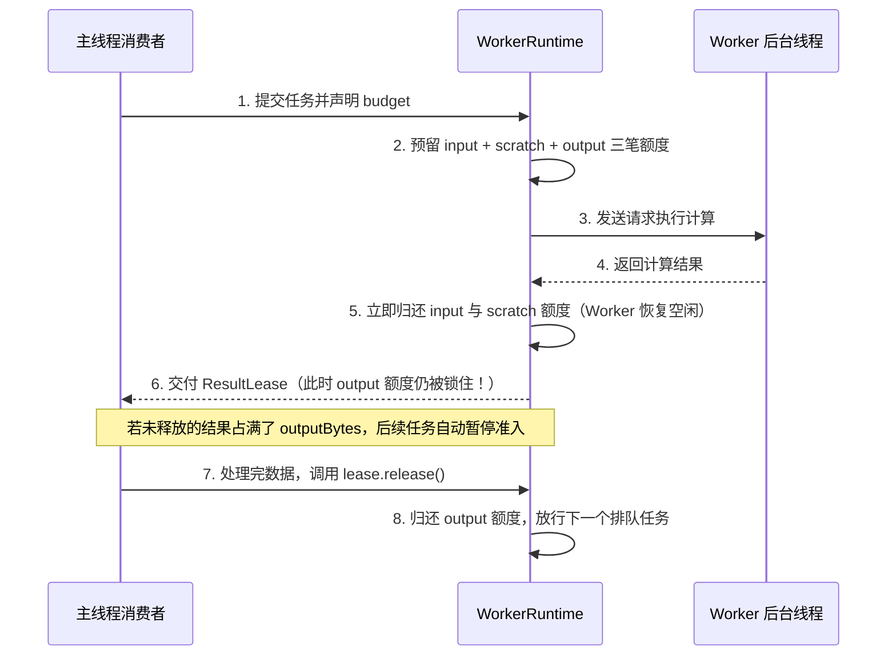

在流式处理或批量计算中，最常见的内存崩溃原因不是“Worker 算得太慢”，恰恰相反，是**“Worker 算得太快，而主线程消化得太慢”**。

举个例子：你开启了 4 个 Worker 解码数据块，每个块算完返回 `8 MiB` 的结果；而主线程拿到每个结果后，需要花 200 毫秒把它上传到网络或写入本地数据库。如果 Worker 一算完就把内存额度全退回去、立刻开足马力算下一块，不到几秒钟，主线程里就会堆积几十个还没来得及写入数据库的 `8 MiB` 结果，直接把内存撑爆。

在工程上，让“下游的消费速度反过来限制上游的生产速度”，就叫做**结果背压（Backpressure）**。`tasklane` 通过 **结果租约（`ResultLease`）** 把这个机制做成了默认行为。



## `ResultLease` 是如何自动踩刹车的？

观察上面的时序图，当第 4 步 Worker 把结果传回主线程时，账本采取了**“分步归还”**策略：

1. **Worker 线程和输入/暂存额度立刻解放**：因为计算已经做完了，`inputBytes` 和 `scratchBytes` 当场归还，这个 Worker 线程也立刻恢复空闲；
2. **输出额度（`outputBytes`）继续被 `ResultLease` 扣留**：这笔输出额度（连同 1 个结果租约名额，全局上限 `maxResultLeases = 1024`）会一直挂在返回的 `ResultLease` 上；
3. **下游没处理完，上游自动排队**：假如全局 `outputBytes` 上限是 `32 MiB`，现在主线程手里已经积压了 4 个各占 `8 MiB` 的结果没处理完，那么 `outputBytes` 就被占满了。此时就算 Worker 线程是空闲的，第 5 个任务也会在队列里安静等待，直到主线程处理完前一个结果、调用了 `release()` 腾出 `8 MiB` 空间为止。

此外，`lease.value` 还做了**延迟解码优化**：只有当你真正去读取 `lease.value` 时，它才会把复合对象还原出来；如果这个结果在读取前就被取消或丢弃了，连反序列化的 CPU 开销都一并省掉。

## 日常怎么用最省心？

### 1. 标准用法：始终用 `consumeResult` 包裹

为了防止你在业务代码里因为某个 `if return` 或报错而忘了调 `lease.release()`（一旦忘调，这笔输出额度就永远不会归还，后面的任务就会卡死！），最安全的做法是始终使用 `consumeResult`：

```ts
await consumeResult(handle, async (value) => {
  // 在这里安心处理结果（比如写入 IndexedDB 或更新画面）
  await saveToDatabase(value);
  // 走出这个大括号时（哪怕上面抛出了异常），consumeResult 都会自动帮你调用 lease.release()！
});
```

如果你确实需要手动拿 `handle.result`，请一定配合 `try ... finally`：

```ts
const lease = await handle.result;
try {
  render(lease.value);
} finally {
  lease.release(); // 释放后如果再读 lease.value，会直接报错 RESULT_RELEASED
}
```

### 2. 不需要返回值的任务：加上 `discardResult: true`

有时候你让 Worker 执行一个任务（比如“把这批数据写进 Worker 内部的 SQLite 表里”），只需要知道它**有没有成功跑完**，根本不需要它返回任何数据。

对于这种任务，千万不要提交一个普通任务然后只写一句 `await handle.settled` 就不管了——因为普通任务成功后依然会生成一个没人去 `release()` 的 `ResultLease` 占着坑位。

正确的写法是在提交任务时声明 **`discardResult: true`**：

```ts
const handle = scope.enqueue('insertRows', {
  pool: 'db',
  discardResult: true, // 告诉 Runtime：算完直接帮我把结果扔掉并退还 outputBytes！
  budget: { inputBytes: 64 * 1024, scratchBytes: 0, outputBytes: 64 },
  prepare: () => ({ payload: rows }),
});

// 依然 await handle.result 来确保任务没有报错（此时拿到的租约已经是自动释放过的状态）
await handle.result;
```

## 源码与契约

- [src/index.ts](https://github.com/mapseekai/tasklane/blob/b40ba606552c4b798ebb803528548151186b364b/src/index.ts)
- [src/resources/lease.ts](https://github.com/mapseekai/tasklane/blob/b40ba606552c4b798ebb803528548151186b364b/src/resources/lease.ts)
- [src/types.ts](https://github.com/mapseekai/tasklane/blob/b40ba606552c4b798ebb803528548151186b364b/src/types.ts)
